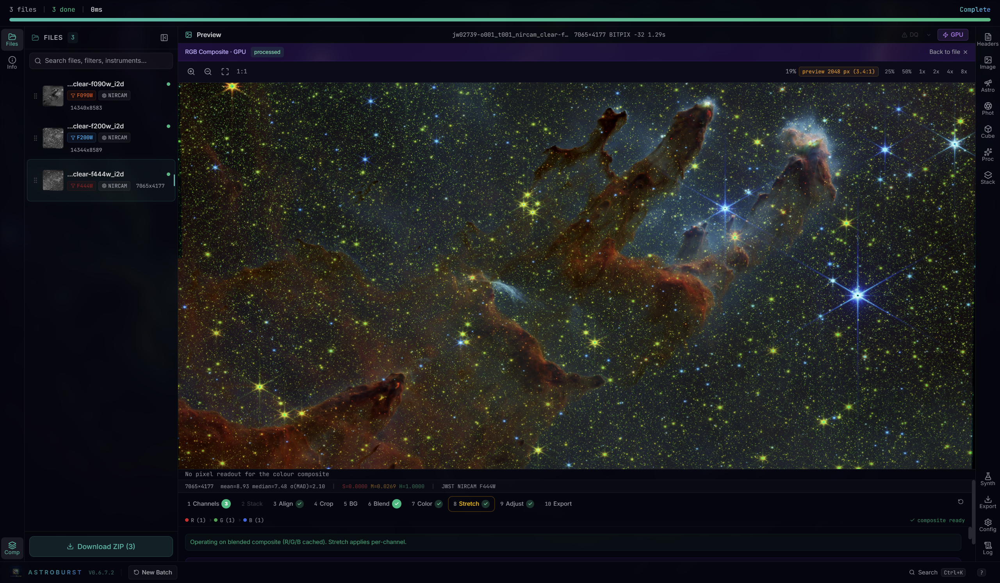
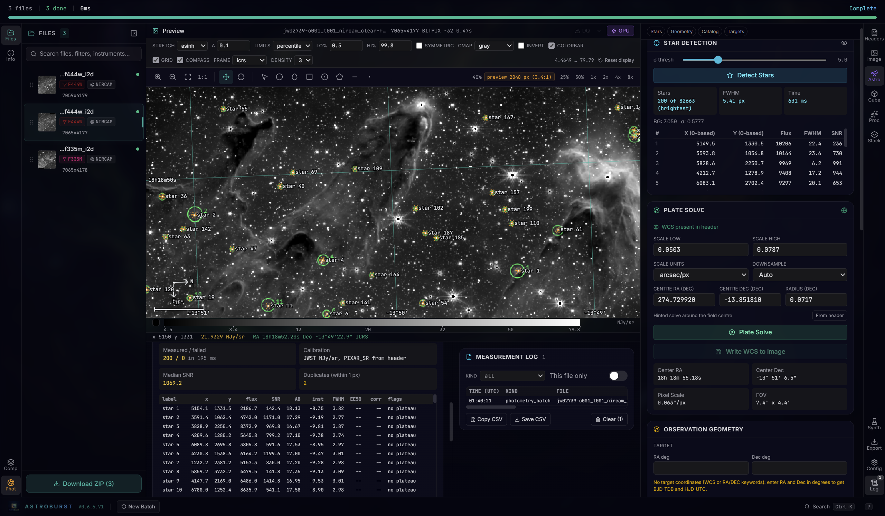
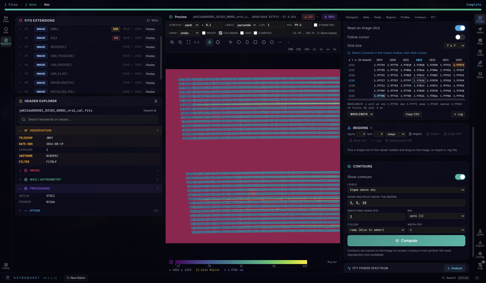
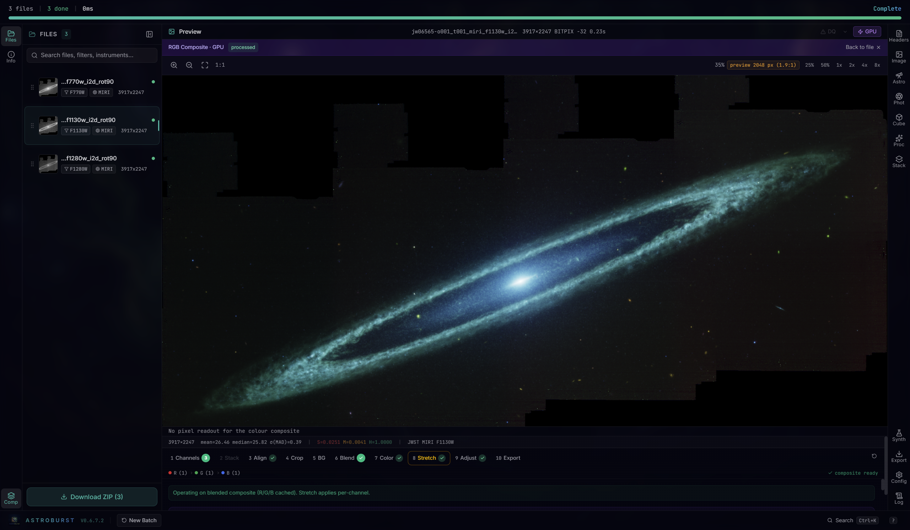
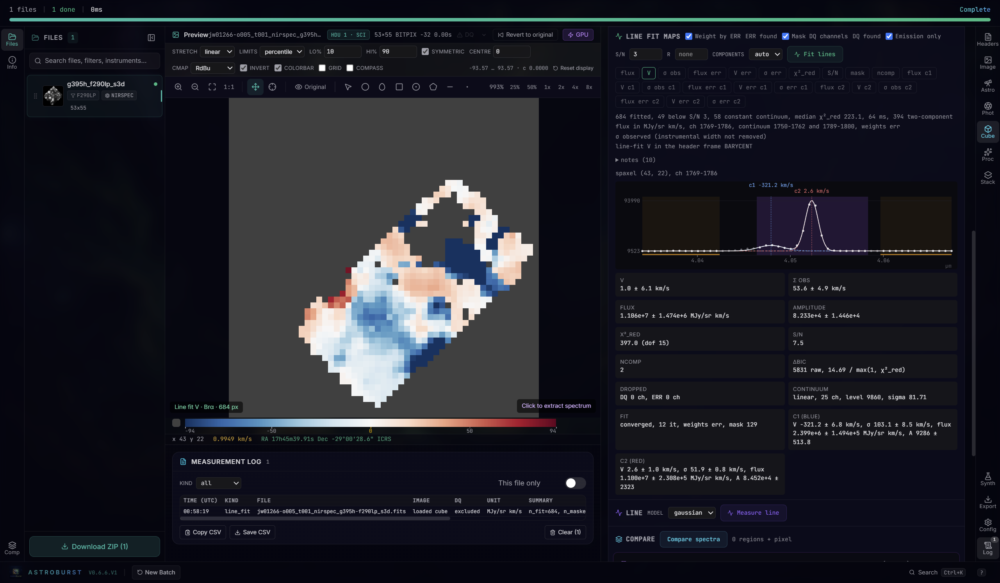

<p align="center">
  
</p>

<h1 align="center">AstroBurst</h1>

<p align="center">
  <strong>A desktop viewer and processing app for FITS and ASDF images, with an optional headless REST API.</strong>
</p>

<p align="center">
  <a href="https://github.com/samuelkriegerbonini-dev/AstroBurst/releases"></a>
  <a href="https://github.com/samuelkriegerbonini-dev/AstroBurst/actions"></a>
  
  <a href="LICENSE"></a>
  
  <a href="https://ko-fi.com/astroburst"></a>
</p>

<p align="center">
  <a href="#what-it-is">What it is</a> &middot;
  <a href="#feature-tour">Features</a> &middot;
  <a href="#install-and-build">Install</a> &middot;
  <a href="#quick-start">Quick start</a> &middot;
  <a href="#headless-server-and-python-client">Server</a> &middot;
  <a href="#supported-formats">Formats</a> &middot;
  <a href="#how-it-compares">Compare</a> &middot;
  <a href="#project-status">Status</a> &middot;
  <a href="#credits-and-acknowledgements">Credits</a>
</p>

---


<p align="center">
  
</p>
<p align="center"><em>The Pillars of Creation from three JWST NIRCam mosaics (jw02739), F444W to red, F200W to green and F090W to blue, aligned through their WCS, level-matched and stretched in the compose wizard.</em></p>

**Version:** 0.7.5. What changed in each release is in [CHANGELOG.md](CHANGELOG.md).

## What it is

AstroBurst opens FITS and ASDF images, displays them, measures them, and composes and exports them. The Rust backend does the processing, React draws the interface, Tauri packages it as a desktop app. A WebGPU shader applies the display stretch and colormap; that is the only place the GPU is used. Everything else, including stacking, alignment, drizzle, deconvolution and compose, runs on the CPU in Rust.

Three reader paths:

- **Quick-look.** Open any FITS HDU or ASDF array, pick a stretch, limits and colormap, read pixel values with their units and WCS position, overlay a coordinate grid, a compass and contours, draw regions and measure them. Start at [Viewer, regions and pixel readout](docs/features.md#viewer-regions-and-pixel-readout).
- **JWST and Roman.** Native ASDF, gWCS evaluation for `_cal` images, per-HDU selection, DQ flag decoding and overlays, DQ-masked statistics, calibrated photometry in AB magnitudes and Jy, cube spectra with line measurement, moment maps, per-spaxel line-fit maps and position-velocity diagrams, science cutouts. Start at [Data quality and units](docs/features.md#data-quality-and-units) and [Science analysis](docs/features.md#science-analysis).
- **Astrophotography.** Calibration with cosmetic correction and dark optimization, integration with the PixInsight rejection family, a ten-step compose wizard, and a processing tab with DBE, PixelMath, wavelets, deconvolution, LHE, HDRMT and curves. Start at [Compose wizard](docs/features.md#compose-wizard) and [Processing](docs/features.md#processing).

Image processing and plate solving run locally first. The solver uses the bundled Tycho-2 catalogue, optional local 2MASS or Siril Gaia DR3 catalogues, or a Gaia DR3 field query through VizieR when the local catalogues are not deep enough. VizieR receives the field centre and radius; the image stays on this computer. Only an explicit Try astrometry.net uploads the image to nova.astrometry.net, and it requires an API key. Gaia refinement, colour calibration (SPCC), the catalog panel and the opt-in Gaia match of click photometry also query VizieR, keeping field queries in a disk cache. The Archive mode searches MAST and downloads its products; optional catalogues and sample data are downloaded on request.

## Feature tour

The full tour, with every screenshot and its caption, is in [docs/features.md](docs/features.md).

**Viewer and regions.** Six stretch curves, four limit algorithms (min/max, IRAF-style zscale, percentile, explicit) and thirteen colormaps, applied by a WebGPU shader, with a CPU viewer when WebGPU is unavailable; a WCS coordinate grid in ICRS, FK5, galactic or ecliptic coordinates, a north/east compass with a scale bar, and a colorbar. Regions (circles, ellipses, boxes, annuli, polygons, lines and points) in pixel or sky coordinates, with background annuli, exclude regions, calibrated fluxes, radial profiles and line cuts, exchanged with DS9 as `.reg` files. The readout gives the value with its unit, the ERR value, the decoded DQ flags and the sky position; an exact PixInsight-style statistics table, a pixel table and dockable tool windows complete the viewer.

<p align="center">
  
</p>
<p align="center"><em>The NIRCam F444W mosaic of the Pillars (jw02739) with the ICRS grid, the compass, the colorbar and batch photometry apertures, the Astrometry tool on the right and the Photometry and Log tools docked below.</em></p>

**Data quality, units and WCS.** Any FITS extension or ASDF array can be displayed and measured (`path#hdu=3`, `path#array=roman.dq`). DQ planes are decoded against the JWST, HST and Roman bit tables, painted as an overlay and left out of statistics, photometry and profiles with one toggle. Header WCS goes through the [wcs-rs](https://github.com/cds-astro/wcs-rs) crate with SIP distortion, and the generalized WCS of JWST `_cal` and Roman `_cal.asdf` images is evaluated transform by transform, compared in the test suite with gwcs 1.0.3.

<p align="center">
  
</p>
<p align="center"><em>A NIRSpec IFU <code>_cal</code> frame (jw01266) with its extensions listed, the JWST DQ overlay between the slices and the wavelength at the cursor.</em></p>

**MAST archive.** An Archive mode beside the Workspace (Ctrl+2) searches JWST, HST and IUE at MAST by target, coordinates, programme or dataset id, with JWST presets, previews, metadata and product lists. Category filters cover all three missions; object-type filters cover JWST and HST, with Combined L3, Exposures L1-2 and All levels controls. Active filters are removable, and dataset categories appear in the results and metadata. Downloads resume after a dropped connection or a Cancel and open in the Workspace; dataset footprints are drawn on the open image through its WCS, and a header peek reads the headers of a FITS product in byte ranges before any download. Roman stays locked until a MAST token is entered.

**Compose and processing.** A ten-step compose wizard (channels, stack, align, crop, background, blend, colour, stretch, adjust, export) reprojects channels through their WCS, matches their levels, blends them with SHO, HOO, Foraxx, Hubble Legacy and wavelength-based presets, calibrates colour against Gaia DR3 with a blackbody approximation (SPCC) and finishes with Fritsch-Carlson tone curves. Calibration and integration cover bias, dark, flat and flat-dark masters with header checks, cosmetic correction, the PixInsight rejection family, star alignment and drizzle. Phase-correlation registration is checked against a star transform when enough stars are available, with rotation and scale handled through that transform when it is decisive; mirrored frames are excluded with a warning. The Processing tab has background extraction and de-banding, wavelet denoise, Richardson-Lucy deconvolution, LHE, HDRMT, Curves, Geometry and PixelMath, with undo, redo and a persistent history.

<p align="center">
  
</p>
<p align="center"><em>The Sombrero, M104, from three MIRI mosaics (jw06565), F1280W, F1130W and F770W, rotated with Geometry, aligned through their WCS and level-matched in the compose wizard.</em></p>

**Plate solving and astrometry.** Solve from position and scale hints taken from the header or entered in the Plate Solve panel, with progress, cancellation, star-match checks and SIP distortion fitting. Settings > Catalogs manages the bundled Tycho-2 catalogue (15.5 MB), an optional 2MASS download (154 MB), an existing Siril Gaia DR3 catalogue or its download from Zenodo, and the VizieR cache. Downloads resume and are checked for integrity. Refine with Gaia DR3 adjusts an existing or newly solved WCS against stars propagated to the observation epoch, reports errors measured on stars held out of the fit, and refuses corrections without enough evidence. Write WCS explicitly saves the result to a copy, with catalogue credits in its HISTORY.

**Science analysis.** Aperture photometry with header zero points in AB magnitudes and Jy, a photometry table, and Gaia DR3 catalogs through VizieR with cross-match and zero point. JWST level-2 `_cal` photometry uses a compatible AREA pixel-area map for fluxes and errors. For cubes and spectra: a full FITS spectral axis with air and vacuum conversion, region spectra with errors, moment maps, per-spaxel line-fit kinematic maps, position-velocity diagrams, line measurement with a rest-frame line list, comparison with the JWST pipeline x1d, and 1D spectra. JWST `_uncal` ramps get a quick-look slope compared with the official `_rate` ([docs/quick-slope.md](docs/quick-slope.md)). Contours, surface-brightness profiles, time series with BJD_TDB and observation geometry, CSV, ETD and ExoClock exports, robust sigma statistics and a session measurement log complete the analysis tools.

<p align="center">
  
</p>
<p align="center"><em>The Br&alpha; velocity map of the Galactic Centre minispiral from a NIRSpec G395H IFU cube (jw01266), with a two-component fit of one spaxel and the measurement log.</em></p>

**Headless server.** The readers, the display controls, the region code, stacking, drizzle and the calibration pipeline also run without a window, behind a REST API: see [Headless server and Python client](#headless-server-and-python-client).

## Install and build

| Platform | Download |
|----------|----------|
| **macOS** (universal: Apple Silicon and Intel) | [`.dmg`](https://github.com/samuelkriegerbonini-dev/AstroBurst/releases/latest) |
| **Windows** | [`.msi`](https://github.com/samuelkriegerbonini-dev/AstroBurst/releases/latest) / [`.exe`](https://github.com/samuelkriegerbonini-dev/AstroBurst/releases/latest) |
| **Linux** | [`.deb`](https://github.com/samuelkriegerbonini-dev/AstroBurst/releases/latest) / [`.AppImage`](https://github.com/samuelkriegerbonini-dev/AstroBurst/releases/latest) / [`.rpm`](https://github.com/samuelkriegerbonini-dev/AstroBurst/releases/latest) |

Install scripts:

```bash
# macOS
curl -fsSL https://raw.githubusercontent.com/samuelkriegerbonini-dev/AstroBurst/main/scripts/install-macos.sh | bash

# Linux (Debian/Ubuntu)
curl -fsSL https://raw.githubusercontent.com/samuelkriegerbonini-dev/AstroBurst/main/scripts/install-linux.sh | bash
```

Flatpak (community-maintained, via [FlatPark](https://github.com/flatpark/flatpark)):

```bash
flatpak remote-add --if-not-exists flatpark https://dl.flatpark.org/flatpark.flatpakrepo
flatpak install flatpark io.github.samuelkriegerbonini_dev.AstroBurst
```

This package is maintained by [jing2uo](https://github.com/jing2uo), not by the AstroBurst project. It downloads the official `.deb` from the GitHub releases unmodified at install time and follows new releases automatically. Permissions and details are on the [FlatPark app page](https://flatpark.org/apps/io.github.samuelkriegerbonini_dev.AstroBurst), and packaging issues go to the [FlatPark tracker](https://github.com/flatpark/flatpark/issues).

Build from source:

```bash
git clone https://github.com/samuelkriegerbonini-dev/AstroBurst.git
cd AstroBurst
pnpm install
pnpm tauri dev
```

`make dev`, `make build`, `make test` and `make lint` wrap the common dev, build, test and lint commands. CI and release builds use Rust 1.96.0, Node.js 22 and pnpm 10; the Tauri CLI is declared in `package.json`. Platform prerequisites are listed in [CONTRIBUTING.md](CONTRIBUTING.md#development-setup). WebGPU (Vulkan, Metal or DX12) is used for the preview when available; without it the app shows a CPU viewer with the grid and compass but without the stretch, limit and colormap controls. Release builds fetch and verify the bundled Tycho-2 catalogue; source builds can use Settings > Catalogs to select a local catalogue.

## Quick start

1. **Drop** a file, a ZIP (nested ZIPs are followed up to a depth limit) or a folder into the window. `.fits`, `.fit`, `.fts`, their `.gz` forms, `.asdf` and `.zip` are recognised.
2. **Look.** Click a file for its preview, histogram and headers. Set stretch, limits, colormap and the coordinate grid in the display bar, or hit Auto STF. Hover for value, unit, ERR, DQ and coordinates. Use the HDU panel to switch to another extension or array. `Ctrl+K` or a double `Shift` opens the command palette over files, tools and actions.
3. **Measure.** Draw a region, add a background annulus, read the statistics. Plot a radial profile or a line cut. Use Plate Solve to solve locally from header or typed hints, optionally Refine with Gaia DR3, then Write WCS to save a copy. Turn on Measure on image click in the Photometry panel, select Crosshair in the viewer toolbar and click a star for calibrated photometry; search Gaia DR3 for a catalog overlay and a zero point. Import or export DS9 `.reg` files.
4. **Compose.** Open the Compose tab and walk the ten steps.
5. **Process.** Debayer, background (polynomial or DBE spline) and de-band, wavelet denoise, PSF estimation, deconvolution, the stretch tools, LHE, HDRMT, Curves, PixelMath and Geometry (rotate and flip) sit in the Processing tab; calibration with flat-darks, cosmetic correction, subframe gating, stacking with the rejection family, the batch pipeline and drizzle in the Stacking tab.
6. **Export.** PNG at 8 or 16 bits, FITS with preserved WCS and metadata, a SCI+ERR+DQ cutout, or a ZIP bundle of all channels plus the composite.

Sample data are downloaded on demand; the installers do not carry them. The empty workspace offers the HST set, the Cube tool offers the JWST sets, and the command palette lists all three:

| Set | Contents | Download |
|-----|----------|----------|
| HST/WFPC2 M16 | [OIII] 502 nm, H-alpha 656 nm and [SII] 673 nm narrowband images | 31 MB |
| JWST/NIRSpec Galactic Centre | IFU cube and 1D spectrum, programme 1266 | 176 MB |
| JWST/MIRI SN 2021aefx | LRS 1D and 2D spectra and a calibrated exposure, programme 2072 | 35 MB |

The HST files come from this repository at a pinned commit; the JWST sets come from AstroBurst's `data-v1` release. Every file is checked against its pinned size and SHA-256. Downloads show progress, can be cancelled and resumed, open the files when complete, and keep them in the Data folder's `samples/` folder. Open sample data reopens them without the network. The HST files are also in [`exampleFits/sample-data/`](exampleFits/sample-data), with a ground-truth catalogue for photometry checks in `synthetic_catalog.csv`. Credits and the JWST data use acknowledgements are listed below and shown before download.

For your own data, MAST and the ESA Hubble Science Archive publish JWST and HST `_cal.fits` and `_i2d.fits` products, and Roman `.asdf` products under instrument WFI. The Archive mode (Ctrl+2) searches MAST, downloads products and opens the downloaded images, cubes, spectra and ramps in the Workspace.

## Headless server and Python client

The headless server and the v2 API were contributed by [Jae-Joon Lee](https://github.com/leejjoon).

`astroburst-server` is a separate Axum binary built behind the `server` feature. It shares the FITS and ASDF readers, the display controls and the region code with the desktop app, renders on the CPU, listens on 127.0.0.1:8080 and serves two API generations: v1 (sessions, render, stacking, drizzle and pipeline runs as async jobs with server-sent events) and v2 (sessions, HDUs, header and WCS inspection, cutouts, coordinates, statistics, histogram and render).

```bash
cd src-tauri
cargo run --bin astroburst-server \
  --no-default-features \
  --features server,astrometry-net,asdf-full,vizier
```

Routes, request and response shapes, configuration, sessions, jobs and errors are in [docs/server-api.md](docs/server-api.md). The async Python client for the v1 API is described in [agent/README.md](agent/README.md), with runnable examples in [`agent/examples/`](agent/examples).

## Supported formats

- **FITS.** Memory-mapped, multi-extension with automatic SCI selection or any HDU by `path#hdu=<n>`; tile-compressed HDUs read through fitsio-pure; `.fits.gz` decompressed as a capped stream; JWST `_uncal` ramps, x1d tables and `-TAB` spectral axes; header keywords written by MaxIm DL, N.I.N.A. and SharpCap read through aliases.
- **ASDF.** A native Rust reader for Roman and JWST pipeline products without Python, with imaging gWCS, Roman L1 ramps and float16 arrays; bzip2 and lz4 come with the `asdf-full` feature.
- **Containers.** ZIP archives, nested ones included, and whole directories.
- **Export.** PNG at 8 or 16 bits, FITS with BITPIX 16, float32 or float64 and optional Rice compression, keeping WCS and provenance cards, RGB FITS cubes and a ZIP bundle.

What each reader supports and refuses is listed in [docs/features.md](docs/features.md#supported-formats).

## How it compares

AstroBurst sits between a viewer and a processing suite, and is behind the established tools in both directions.

- **DS9** is the reference FITS viewer. AstroBurst matches most of its inspection surface: stretch and limit algorithms, colormaps, frames, a coordinate grid, a compass, contours, region shapes with DS9 `.reg` exchange, per-region statistics, a pixel table and a Gaia catalog overlay. DS9 is ahead on frame management and blinking, image-server integration, 3D rendering, and interoperability through SAMP and XPA, none of which AstroBurst has.
- **jdaviz** is the JWST and Roman quick-look toolset from STScI. AstroBurst overlaps on ASDF, DQ decoding, unit-aware readout, calibrated photometry, cube spectra with line lists and line measurement, and moment maps, and opens those files without Python. jdaviz is ahead on model fitting (AstroBurst fits one Gaussian per line, or at most two per spaxel in its line-fit maps), Mosviz-style multi-object work, and lives inside a notebook where results are scriptable end to end.
- **Siril** is the closest free processing comparison. Calibration, registration, integration (rejection families, normalization, drizzle with rejection, cosmetic correction, dark optimization) and stretching are at a comparable level of algorithmic depth. Siril has a mature scripting language, RAW and XISF input, a much larger user base and years of field testing; AstroBurst has no scripting language yet.
- **PixInsight** is the commercial reference for processing depth. AstroBurst now covers the core of ImageIntegration, CosmeticCorrection, DynamicBackgroundExtraction, PixelMath, LocalHistogramEqualization, HDRMultiscaleTransform, Statistics and NoiseEvaluation, each as a single tool with the essential parameters. PixInsight keeps mosaic stitching, a process container, masks and previews as first-class objects, modern deconvolution, and an enormous body of published workflows.

Where AstroBurst is genuinely different: a single desktop app that reads ASDF natively without Python, decodes DQ against named instrument bit tables, and exposes the same readers, display controls and region code through a headless REST API.

## Project status

Pre-1.0, developed by one maintainer with outside contributions. Formats, command names and the REST API may change before 1.0.

Version 0.7.5 adds local-first plate solving, Gaia DR3 WCS refinement, catalogue management, MAST filters and scientific export and photometry improvements. The FITS and ASDF readers, display path, compose wizard and export are used daily; newer processing and science tools have had less time in the field. The [technical document](docs/astroburst_technical_document.pdf) (release 0.7.0) describes the algorithms and the rules behind each step; [CHANGELOG.md](CHANGELOG.md) records later changes. CI checks the TypeScript types, a production build, eslint with zero warnings allowed, the Rust library on Windows, all Rust features on Ubuntu and macOS (including the headless server), the vitest suite and the Node.js script tests.

Real-data validation of the local solver found 46 of 48 DSS2 fields of 0.4 degrees and wider solved with 2MASS, and 23 of 24 fields of 1 degree and wider with Tycho-2 alone, with no false solution in those tests. On the tested JWST FGS fields of the LMC, Gaia refinement reduced a 1.77 arcsec header offset to a hold-out RMS of 34 to 44 mas. These results describe the tested fields, not a general accuracy guarantee.

Known limits:

- There is no published performance benchmark suite covering the whole app; the real-data validation above covers specific scientific cases.
- The GPU is used for display only. Every algorithm runs on the CPU in Rust.
- Local plate solving needs usable centre and scale hints. Tycho-2 alone is suited to wider fields; narrower fields need a deeper local catalogue or an online Gaia query. Blind offline solving is not available. Uneven star coverage in dusty or nebulous fields can cause a correct candidate to be refused, and tested TESS frames retain corner differences of up to about 3 pixels from the mission WCS.
- Gaia refinement, the catalog panel and the optional Gaia match of click photometry need VizieR for a field not yet in the disk cache; SPCC falls back to a synthetic catalogue without it. Only the optional astrometry.net fallback needs an API key and uploads the image.
- TAN headers with SCAMP-style PV distortion cards keep their linear TAN solution and report unapplied distortion. Full TPV support is not available; explicit `RA---TPV` headers are refused.
- SPCC is a blackbody approximation at the channel wavelengths, not a fit to Gaia XP spectra through filter transmission curves.
- Only imaging gWCS is evaluated. Spectroscopic gWCS and chains with `tabular`, `fix_inputs` or JWST pipeline model transforms fall back to the header WCS, or leave a Roman ASDF image without one.
- The headless server covers rendering, pixel probes, statistics, histograms, cutouts, coordinate conversion, binning, the coordinate grid, WCS inspection, stacking, drizzle and the calibration pipeline; every other tool, from the DQ overlay, DQ-masked statistics, exclude regions and `.reg` exchange to photometry, cube science, the processing tools, the compose wizard and the MAST archive, is desktop-only.
- The Python client covers the v1 API only.
- Integration holds every frame in memory; very large frame counts need a machine with matching RAM.
- Solved-WCS copies and derived maps are written to the output folder, which is cleared at launch; save or move products you want to keep. The measurement log is session-only; Save CSV keeps its rows.
- The coordinate grid and regions are not drawn in the standalone deep-zoom tile viewer.
- No SAMP or XPA interoperability, no mosaic stitching, no plugin or scripting system, no RAW or XISF input.

Planned work includes broader scientific validation, blind offline solving, extended WCS support, masks and processing presets, additional image formats, more science tools in the headless API, and integration that handles frame sets larger than RAM. Longer-term work includes GPU compute for stacking and alignment, and plugin hooks.

## Credits and acknowledgements

- **Contributors.** [Jae-Joon Lee](https://github.com/leejjoon): the headless server, the v2 API, the Python client, the WCS engine migration, FITS tile compression, zscale and the first colormaps (gray and viridis). [jing2uo](https://github.com/jing2uo) maintains the Flatpak through [FlatPark](https://github.com/flatpark/flatpark).
- **Sample data.** The HST/WFPC2 narrowband frames of M16: NASA, ESA, J. Hester and P. Scowen (Arizona State University), public domain, from the Hubble archive at STScI. The JWST/NIRSpec Galactic Centre set is from programme 1266 (PI M. Garcia Marin), and the JWST/MIRI SN 2021aefx set is from programme 2072 (PI S. W. Jha): NASA, ESA, CSA, data via MAST at STScI. See the [JWST sample data notice](src-tauri/licenses/jwst-sample-data-NOTICE.txt) for the requested acknowledgements.
- **Screenshot data.** JWST programmes jw02739 (Pillars of Creation, NIRCam and MIRI), jw06565 (M104, NIRCam and MIRI), jw02016 (M104, MIRI MRS), jw01266 (Galactic Centre, NIRSpec IFU) and jw01476 (LMC, FGS) from MAST, a simulated Roman WFI L2 image, and the HST/WFPC2 M16 frames.
- **Services.** Gaia DR3 through VizieR at CDS (plate solving, WCS refinement, colour calibration, catalogs and the Gaia match of click photometry), nova.astrometry.net (the optional plate-solving fallback) and MAST at STScI (the Archive mode).
- **Star catalogues.** The bundled Tycho-2 catalogue is built from CDS I/259 (Hog et al. 2000), based on the ESA Hipparcos mission: Credit: ESA; data obtained from the CDS, Strasbourg, France. The [Tycho-2 notice](src-tauri/licenses/tycho2-catalogue-NOTICE.txt) records both source statements of its terms. Optional 2MASS data: Two Micron All Sky Survey, University of Massachusetts and IPAC/Caltech, funded by NASA and NSF. Gaia DR3: Gaia Collaboration, Vallenari et al. 2023, ESA/Gaia/DPAC, CC BY-NC 3.0 IGO, via VizieR (CDS) or the Siril extract from Zenodo record 14692304. Settings > Catalogs manages the optional downloads. AstroBurst does not bundle, host or redistribute Gaia data.
- **Libraries and references.** [wcs-rs](https://github.com/cds-astro/wcs-rs) by CDS for header WCS ([ADR 0001](docs/adr/0001-wcs-rs-for-wcs-engine.md)); fitsio-pure for tile-compressed FITS; matplotlib colormap knots; IRAF zscale; wcslib interpolation rules for `-TAB` axes; Greisen et al. 2006 for air and vacuum wavelengths; Kasten-Young airmass; Fritsch-Carlson monotone splines; BT.709 luminance weights; the Foraxx and Hubble Legacy palettes; header aliases for MaxIm DL, N.I.N.A. and SharpCap. Named methods: the GHS stretch, Winsorized sigma clipping, the biweight midvariance (BWMV), RANSAC star matching, the Lanczos3 drizzle kernel, Tikhonov-regularized Richardson-Lucy deconvolution, CLAHE, the PixInsight MLT-style detail bias and SCNR, and the Petrosian radius. Instrument and camera conventions: the JWST pipeline's tweakreg correction, the `GAIN` card of ZWO, QHY and ASCOM cameras, and the Bayer and X-Trans CFA layouts. The gWCS evaluator is compared with gwcs 1.0.3 and the barycentric times with astropy. The Python client's image helper uses Pillow. Built with Tauri, React and WebGPU.
- **Compared with.** DS9, jdaviz (STScI), Siril and PixInsight, in [How it compares](#how-it-compares).
- **Documentation.** [CHANGELOG.md](CHANGELOG.md), the [technical document](docs/astroburst_technical_document.pdf), the full [feature tour](docs/features.md), the [server route reference](docs/server-api.md), the [Python client](agent/README.md) and [docs/quick-slope.md](docs/quick-slope.md).

## Contributing

Setup, code style, tests, the architecture overview and the current priority areas are in [CONTRIBUTING.md](CONTRIBUTING.md), so there is one list to keep current. Contributions require the [CLA](CLA.md). Please read the [Code of Conduct](CODE_OF_CONDUCT.md), and report security issues through [SECURITY.md](SECURITY.md).

The headless server, the v2 API, the Python client, the WCS engine migration, FITS tile compression, zscale and the first colormaps (gray and viridis) were contributed by [Jae-Joon Lee](https://github.com/leejjoon).

AstroBurst is free and AGPLv3. If it helps your work, you can [support development on Ko-fi](https://ko-fi.com/astroburst).

<!-- SUPPORTERS:START -->
<!-- SUPPORTERS:END -->

## License

AGPLv3. See [LICENSE](LICENSE).

The network clause (section 13) covers the optional headless REST API: if you run a
modified AstroBurst as a network service, you must offer the modified source to its users.

Third-party licence notices are in [src-tauri/licenses/THIRD-PARTY-NOTICES.md](src-tauri/licenses/THIRD-PARTY-NOTICES.md) and ship with the desktop installers and the Linux tarball.

---

<p align="center">
  <sub>Created by <a href="https://github.com/samuelkriegerbonini-dev">Samuel Krieger</a></sub>
</p>
