<p align="center">
  
</p>

<h1 align="center">AstroBurst</h1>

<p align="center">
  <strong>A desktop viewer and processing app for FITS and ASDF images, with an optional headless REST API.</strong>
</p>

<p align="center">
  <a href="https://github.com/samuelkriegerbonini-dev/AstroBurst/releases"></a>
  <a href="https://github.com/samuelkriegerbonini-dev/AstroBurst/actions"></a>
  
  <a href="LICENSE"></a>
  
  <a href="https://ko-fi.com/astroburst"></a>
</p>

<p align="center">
  <a href="#what-it-is">What it is</a> &middot;
  <a href="#images">Images</a> &middot;
  <a href="#ifu-cubes">Cubes</a> &middot;
  <a href="#1d-spectra-and-jwst-time-series">Spectra</a> &middot;
  <a href="#survey-images-and-unresolved-sources">Surveys</a> &middot;
  <a href="#install-and-build">Install</a> &middot;
  <a href="#quick-start">Quick start</a> &middot;
  <a href="#limits">Limits</a> &middot;
  <a href="#credits-and-acknowledgements">Credits</a>
</p>

---


<p align="center">
  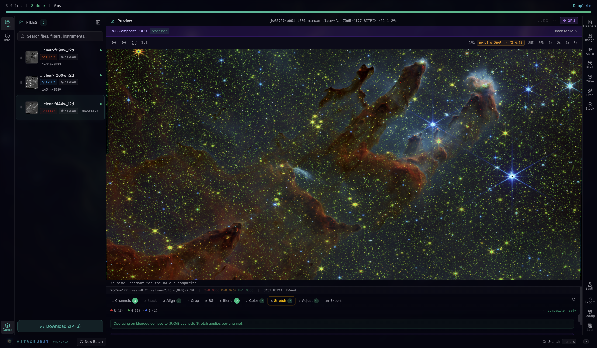
</p>
<p align="center"><em>The Pillars of Creation from three JWST NIRCam mosaics (jw02739), F444W to red, F200W to green and F090W to blue, aligned through their WCS, level-matched and stretched in the compose wizard.</em></p>

**Version:** 0.9.0. What changed in each release is in [CHANGELOG.md](CHANGELOG.md).

## What it is

AstroBurst opens FITS and ASDF images, cubes, spectra and tables, displays them, measures them, and composes and exports them. The Rust backend does the processing, React draws the interface and Tauri packages it as a desktop app; the GPU only applies the display stretch and colormap. Everything runs on this computer: VizieR (Gaia DR3), MAST and the optional catalogues are contacted only by the features that need them, and an image leaves the computer only through an explicit Try astrometry.net. The full tour, with every screenshot, is in [docs/features.md](docs/features.md).

### Images

- View any FITS HDU or ASDF array with six stretches, four limit algorithms and thirteen colormaps, a WCS grid, compass and contours, decoded DQ flags and a readout with unit, error and sky position; draw regions and exchange them with DS9.
- Calibrate, stack with the PixInsight rejection family, drizzle, and join mosaics by WCS; compose colour images in a ten-step wizard; process with DBE, PixelMath, wavelets, deconvolution, LHE, HDRMT, curves and masks.
- Plate solve on this computer against the bundled Tycho-2 catalogue, refine the WCS against Gaia DR3, and evaluate the gWCS of JWST and Roman images.
- Aperture photometry in AB magnitudes and Jy with the calibration and its origin stated, a photometry table, the Gaia DR3 cross-match and zero point, and time series with BJD_TDB and ETD and ExoClock exports.

<p align="center">
  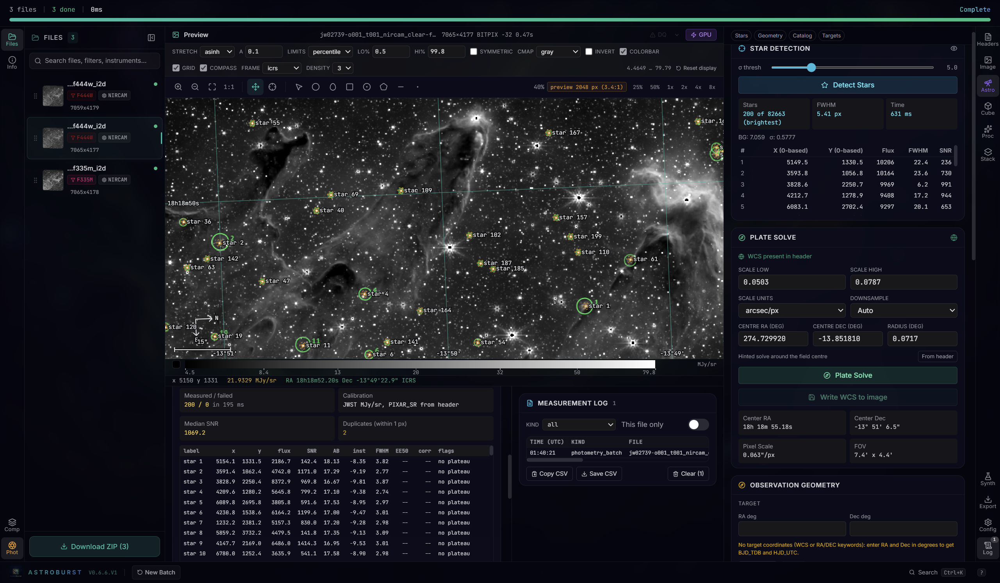
  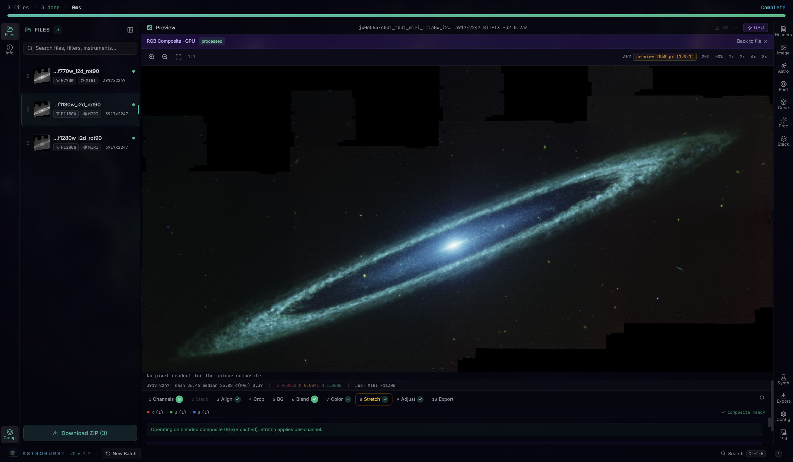
</p>
<p align="center"><em>Left, the NIRCam F444W mosaic of the Pillars (jw02739) with the grid, compass, colorbar and batch photometry apertures. Right, the Sombrero from three MIRI mosaics (jw06565), aligned through their WCS and level-matched in the compose wizard.</em></p>

### IFU cubes

- Region spectra with errors and sky subtraction, channel collapse, moment maps and position-velocity diagrams, without loading the cube whole.
- Per-spaxel line-fit maps with one or two Gaussian components, ERR weights and DQ masking, in the observer frame or, at a redshift, in the frame of the source.
- Line measurement against a rest-frame line list, and comparison with the JWST pipeline x1d.
- JWST `_uncal` ramps with a quick-look slope, and Cube Prep and SAGUI for multiband cubes ([guide](docs/scientific-desktop.md)).

<p align="center">
  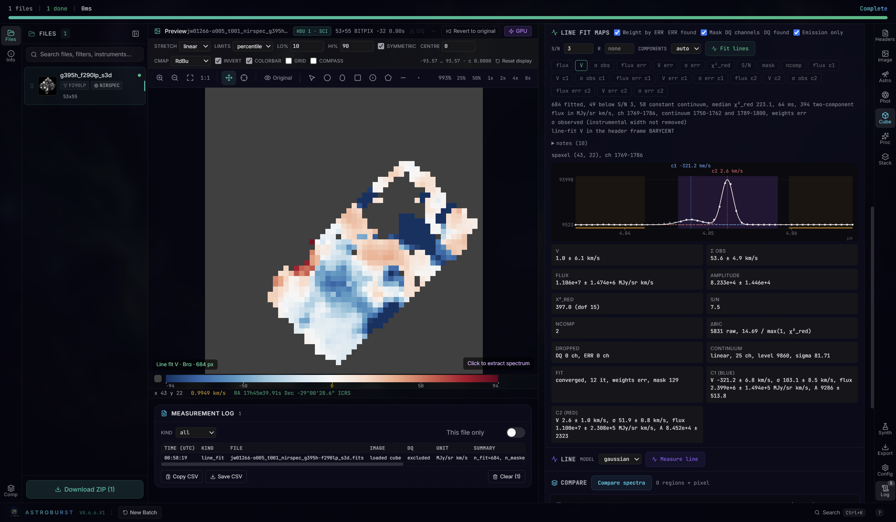
  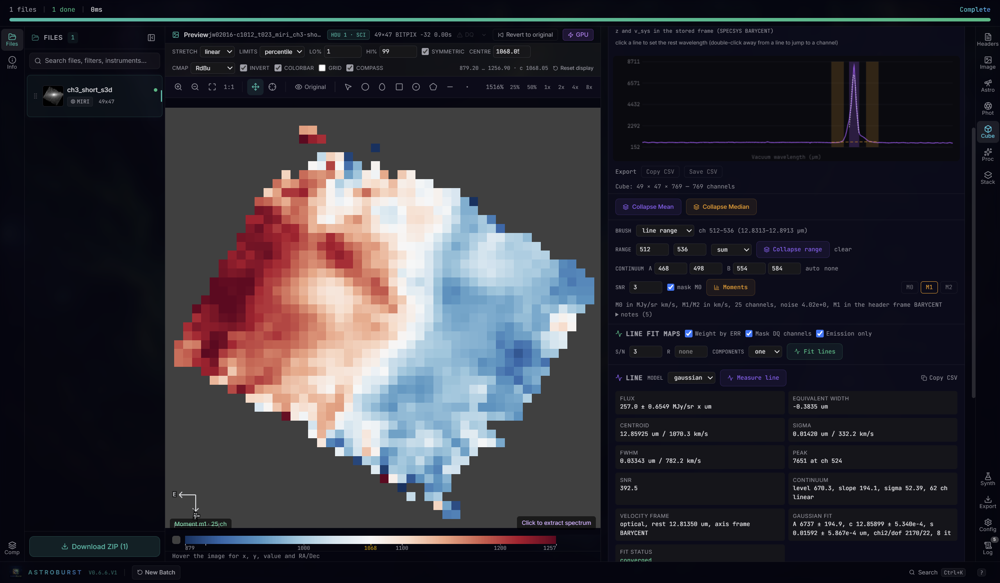
</p>
<p align="center"><em>Left, the Br&alpha; velocity map of the Galactic Centre minispiral from a NIRSpec G395H cube (jw01266), with a two-component fit of one spaxel. Right, [NeII] at the nucleus of M104 in a MIRI MRS cube (jw02016), its moment-1 map and the measured line.</em></p>

### 1D spectra and JWST time series

- 1D spectra and x1d tables open in the Spectra tool and in the main viewer, in &micro;m, nm or &Aring; and in Jy, mJy, &micro;Jy, F<sub>&lambda;</sub> or AB magnitudes, binned or not, with molecular and atomic bands marked.
- Line measurement with one-sigma errors, the redshift of each line and the integrated line flux in W m<sup>-2</sup> and erg s<sup>-1</sup> cm<sup>-2</sup>.
- JWST time-series spectra (`x1dints`): white light and wavelength bins as the pipeline computes them, checked against its `_whtlt.ecsv`, a quick-look depth spectrum and a fitted transmission spectrum.
- Light curves from images, time-series spectra or saved tables: a quick look, a period search and a least-squares transit or eclipse fit with errors, saved as CSV with their provenance.

<p align="center">
  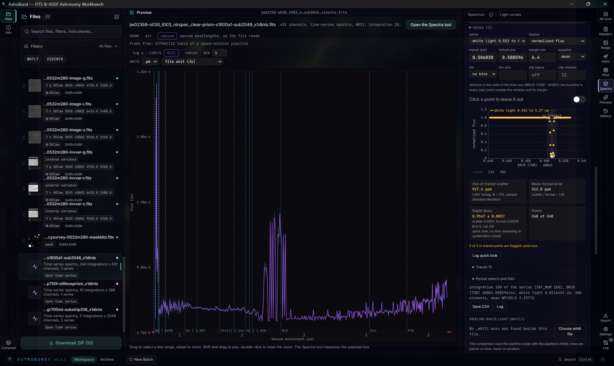
  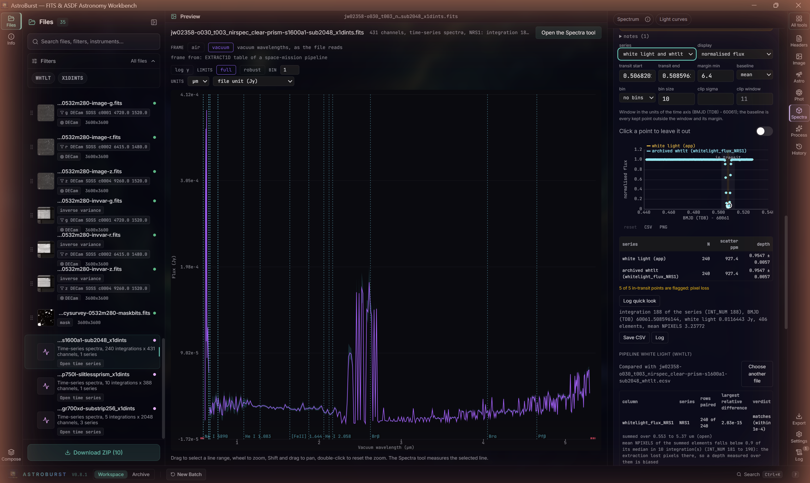
  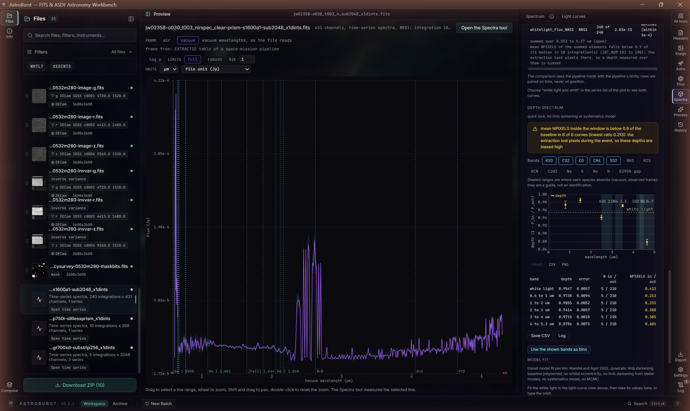
</p>
<p align="center">
  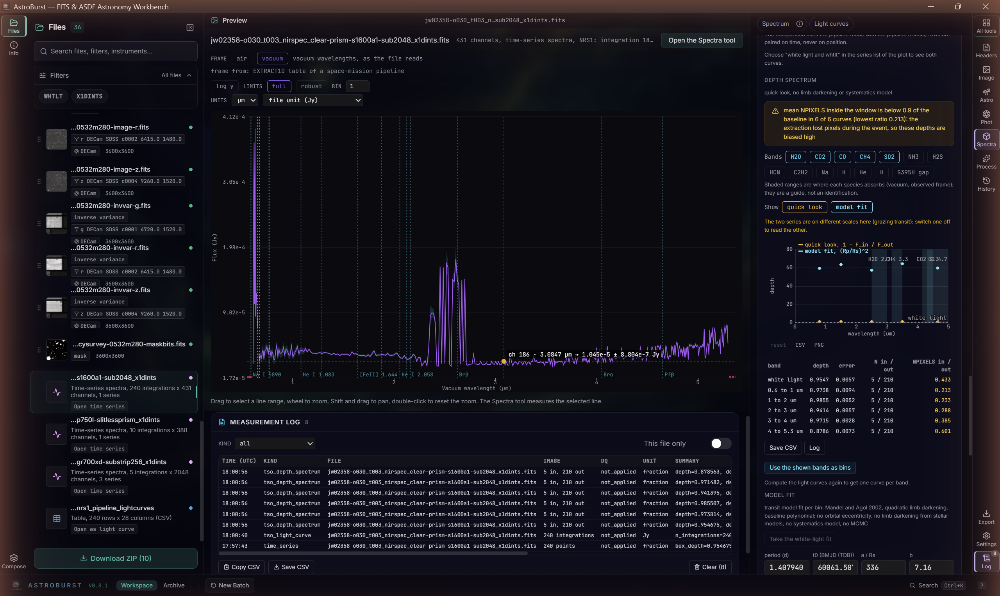
  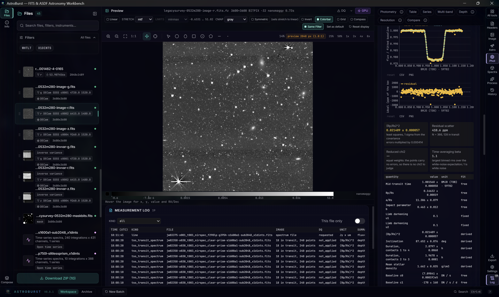
  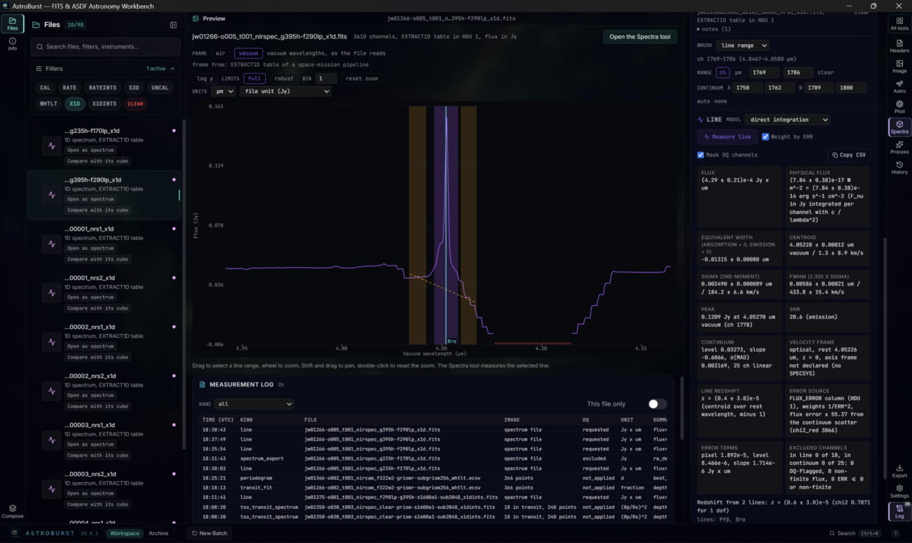
</p>
<p align="center"><em>Top: a NIRSpec PRISM time series of WD 1856+534 b (jw02358), its white light, the pipeline's white light drawn over it, and the quick-look depth spectrum. Bottom: the fitted transmission spectrum of the same set, a transit fit of WASP-39 b from a NIRCam white-light table, and a line measured on a NIRSpec G395H x1d (jw01266).</em></p>

### Survey images and unresolved sources

- Survey files as the archives deliver them: `.fits.bz2` frames, tile-compressed masks, Pan-STARRS asinh pixels, single bands of a cutout cube, and the error and mask layers of the same file or the files beside it (Legacy Surveys, DES, Euclid, Pan-STARRS, SDSS, Rubin and HSC conventions).
- Calibration from the pixel unit (nanomaggy, nJy, ...) or the survey zero point, with the origin of the calibration stated, or from a zero point you type.
- Forced photometry of a list of sky positions in up to 12 band images, with colours, upper limits and the SED of each source, and a comparison with the survey's own catalogue.
- The depth of an image from empty apertures, the PSF of the image, and whether a source is resolved, with sizes in kpc at a redshift.

<p align="center">
  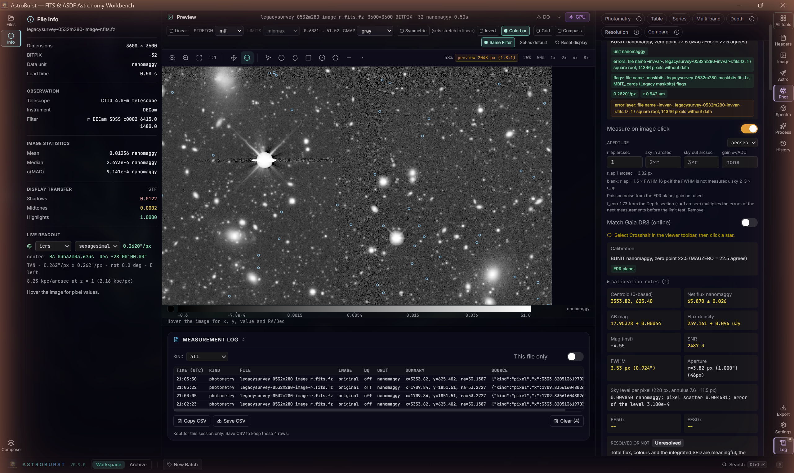
  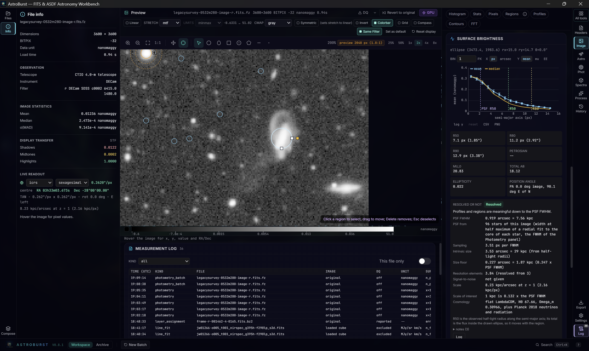
</p>
<p align="center">
  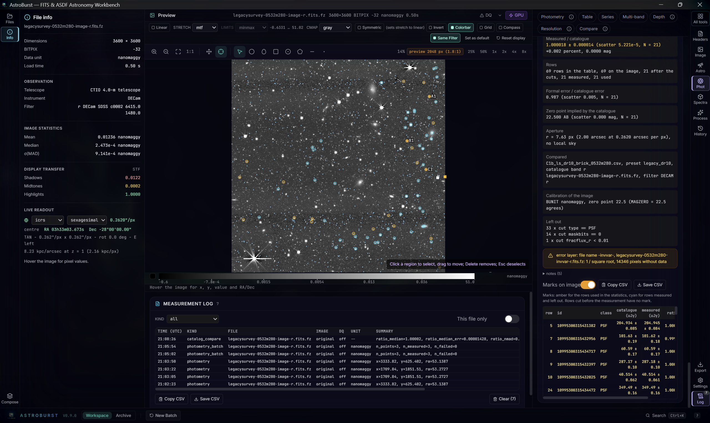
  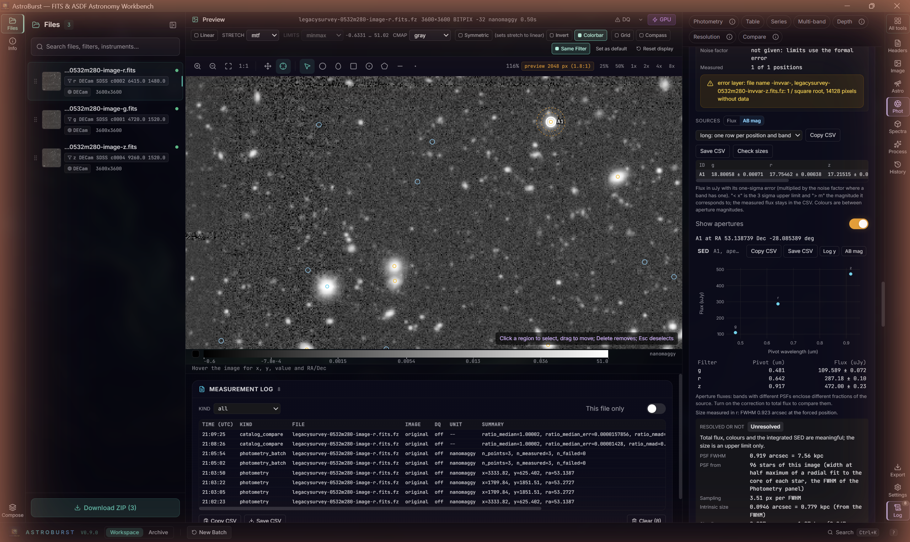
</p>
<p align="center"><em>Legacy Surveys DR10 data. Top: a star measured with its calibration, error layer and PSF verdict stated, and a galaxy profile against the PSF. Bottom: the photometry compared with the brick's own catalogue, and forced g, r, z photometry with the SED of one source.</em></p>

## Install and build

| Platform | Download |
|----------|----------|
| **macOS** (universal: Apple Silicon and Intel) | [`.dmg`](https://github.com/samuelkriegerbonini-dev/AstroBurst/releases/latest) |
| **Windows** | [`.msi`](https://github.com/samuelkriegerbonini-dev/AstroBurst/releases/latest) / [`.exe`](https://github.com/samuelkriegerbonini-dev/AstroBurst/releases/latest) |
| **Linux** | [`.deb`](https://github.com/samuelkriegerbonini-dev/AstroBurst/releases/latest) / [`.AppImage`](https://github.com/samuelkriegerbonini-dev/AstroBurst/releases/latest) / [`.rpm`](https://github.com/samuelkriegerbonini-dev/AstroBurst/releases/latest) |

Install scripts:

```bash
# macOS
curl -fsSL https://raw.githubusercontent.com/samuelkriegerbonini-dev/AstroBurst/main/scripts/install-macos.sh | bash

# Linux (Debian/Ubuntu)
curl -fsSL https://raw.githubusercontent.com/samuelkriegerbonini-dev/AstroBurst/main/scripts/install-linux.sh | bash
```

Flatpak (community-maintained, via [FlatPark](https://github.com/flatpark/flatpark)):

```bash
flatpak remote-add --if-not-exists flatpark https://dl.flatpark.org/flatpark.flatpakrepo
flatpak install flatpark io.github.samuelkriegerbonini_dev.AstroBurst
```

This package is maintained by [jing2uo](https://github.com/jing2uo), not by the AstroBurst project. It downloads the official `.deb` from the GitHub releases unmodified at install time and follows new releases automatically. Permissions and details are on the [FlatPark app page](https://flatpark.org/apps/io.github.samuelkriegerbonini_dev.AstroBurst), and packaging issues go to the [FlatPark tracker](https://github.com/flatpark/flatpark/issues).

Build from source:

```bash
git clone https://github.com/samuelkriegerbonini-dev/AstroBurst.git
cd AstroBurst
pnpm install
pnpm tauri dev
```

`make dev`, `make build`, `make test` and `make lint` wrap the common dev, build, test and lint commands. CI and release builds use Rust 1.96.0, Node.js 22 and pnpm 10; the Tauri CLI is declared in `package.json`. Platform prerequisites are listed in [CONTRIBUTING.md](CONTRIBUTING.md#development-setup). WebGPU (Vulkan, Metal or DX12) is used for the preview when available; without it the app shows a CPU viewer with the grid and compass but without the stretch, limit and colormap controls. Release builds fetch and verify the bundled Tycho-2 catalogue; source builds can use Settings > Catalogs to select a local catalogue.

## Quick start

1. **Drop** a file, a ZIP (nested ZIPs are followed up to a depth limit) or a folder into the window. `.fits`, `.fit` and `.fts` files and their `.gz` and `.bz2` forms, `.fits.fz`, `.asdf`, `.zip`, and `.csv` and `.ecsv` tables are recognised.
2. **Look.** Click a file for its preview, histogram and headers; set stretch, limits, colormap and grid in the display bar, or hit Auto STF. The HDU panel switches to another extension, array or band. `Ctrl+K` or a double `Shift` opens the command palette.
3. **Measure.** Draw a region and read its statistics, or use the Photometry tool (a click, a table, a time series, several bands), the Spectra tool (spectra, cubes, time series, ramps) and Plate Solve. Results go to the measurement log and to CSV files.
4. **Compose and process.** The Compose tab walks the ten steps; the Processing and Stacking tabs hold the processing tools, calibration, stacking, drizzle and mosaics.
5. **Export.** PNG at 8 or 16 bits, FITS with its WCS and metadata, a SCI+ERR+DQ cutout, or a ZIP bundle.

Sample data are downloaded on demand; the installers do not carry them. The empty workspace offers the HST set and the Spectra tool offers the JWST sets; the command palette lists the HST download while the workspace is empty, the JWST downloads while a file is shown, and every set already downloaded:

| Set | Contents | Download |
|-----|----------|----------|
| HST/WFPC2 M16 | [OIII] 502 nm, H-alpha 656 nm and [SII] 673 nm narrowband images | 31 MB |
| JWST/NIRSpec Galactic Centre | IFU cube and 1D spectrum, programme 1266 | 176 MB |
| JWST/MIRI SN 2021aefx | LRS 1D and 2D spectra and a calibrated exposure, programme 2072 | 35 MB |

Every file is checked against its pinned size and SHA-256, and downloads resume after a Cancel. The HST files are also in [`exampleFits/sample-data/`](exampleFits/sample-data). For your own data, MAST and the ESA Hubble Science Archive publish JWST and HST products and Roman `.asdf` products; the Archive mode (Ctrl+2) searches MAST, downloads products and opens them, tables included, in the Workspace. What each reader supports and refuses is in [docs/features.md](docs/features.md#supported-formats).

## Headless server and Python client

The headless server and the v2 API were contributed by [Jae-Joon Lee](https://github.com/leejjoon).

`astroburst-server` is a separate Axum binary built behind the `server` feature. It shares the readers, the display controls and the region code with the desktop app, renders on the CPU, listens on 127.0.0.1:8080, and runs rendering, statistics, cutouts, stacking, drizzle and the calibration pipeline. Routes are in [docs/server-api.md](docs/server-api.md); the Python client for the v1 API is in [agent/README.md](agent/README.md).

```bash
cd src-tauri
cargo run --bin astroburst-server \
  --no-default-features \
  --features server,astrometry-net,asdf-full,vizier
```

## Limits

AstroBurst is pre-1.0 and developed by one maintainer with outside contributions; formats, command names and the REST API may change. Transit and eclipse fits are weighted least squares (no MCMC, circular orbits only), there is no atmospheric retrieval, survey photometry is measured at given positions without source detection or deblending, the SED is shown and not fitted, and local plate solving needs centre and scale hints. Many tools are desktop-only, and there is no SAMP, XPA, scripting, RAW or XISF input. What was validated on real data, and every other limit, is in [docs/features.md](docs/features.md), the [technical document](docs/astroburst_technical_document.pdf) and [CHANGELOG.md](CHANGELOG.md).

## Credits and acknowledgements

- **Contributors.** [Jae-Joon Lee](https://github.com/leejjoon): the headless server, the v2 API, the Python client, the WCS engine migration, FITS tile compression, zscale and the first colormaps (gray and viridis). [jing2uo](https://github.com/jing2uo) maintains the Flatpak through [FlatPark](https://github.com/flatpark/flatpark).
- **Sample data.** The HST/WFPC2 narrowband frames of M16: NASA, ESA, J. Hester and P. Scowen (Arizona State University), public domain, from the Hubble archive at STScI. The JWST/NIRSpec Galactic Centre set is from programme 1266 (PI M. Garcia Marin), and the JWST/MIRI SN 2021aefx set is from programme 2072 (PI S. W. Jha): NASA, ESA, CSA, data via MAST at STScI. See the [JWST sample data notice](src-tauri/licenses/jwst-sample-data-NOTICE.txt) for the requested acknowledgements.
- **Screenshot data.** JWST programmes jw02739 (Pillars of Creation, NIRCam and MIRI), jw06565 (M104, NIRCam and MIRI), jw02016 (M104, MIRI MRS), jw01266 (Galactic Centre, NIRSpec IFU and G395H x1d), jw01476 (LMC, FGS) and jw02358 (WD 1856+534 b, NIRSpec PRISM time series) and a NIRCam white-light table of WASP-39 b from MAST, a simulated Roman WFI L2 image, the HST/WFPC2 M16 frames, and the Legacy Surveys DR10 images, griz cutout and catalogue of brick 0532m280.
- **Services.** Gaia DR3 through VizieR at CDS (plate solving, WCS refinement, colour calibration, catalogs and the Gaia match of click photometry), nova.astrometry.net (the optional plate-solving fallback) and MAST at STScI (the Archive mode).
- **Star catalogues.** The bundled Tycho-2 catalogue is built from CDS I/259 (Hog et al. 2000), based on the ESA Hipparcos mission: Credit: ESA; data obtained from the CDS, Strasbourg, France. The [Tycho-2 notice](src-tauri/licenses/tycho2-catalogue-NOTICE.txt) records both source statements of its terms. Optional 2MASS data: Two Micron All Sky Survey, University of Massachusetts and IPAC/Caltech, funded by NASA and NSF. Gaia DR3: Gaia Collaboration, Vallenari et al. 2023, ESA/Gaia/DPAC, CC BY-NC 3.0 IGO, via VizieR (CDS) or the Siril extract from Zenodo record 14692304. Settings > Catalogs manages the optional downloads. AstroBurst does not bundle, host or redistribute Gaia data.
- **Libraries and references.** [wcs-rs](https://github.com/cds-astro/wcs-rs) by CDS for header WCS ([ADR 0001](docs/adr/0001-wcs-rs-for-wcs-engine.md)); fitsio-pure for tile-compressed FITS; matplotlib colormap knots; IRAF zscale; wcslib interpolation rules for `-TAB` axes; Morton 2000 for air and vacuum wavelengths; Kasten-Young airmass; Fritsch-Carlson monotone splines; BT.709 luminance weights; the Foraxx and Hubble Legacy palettes; header aliases for MaxIm DL, N.I.N.A. and SharpCap. Named methods: the GHS stretch, Winsorized sigma clipping, the biweight midvariance (BWMV), RANSAC star matching, the Lanczos3 drizzle kernel, Tikhonov-regularized Richardson-Lucy deconvolution, CLAHE, the PixInsight MLT-style detail bias and SCNR, the Petrosian radius, the Mandel and Agol (2002) transit model, the generalised Lomb-Scargle periodogram (Zechmeister and Kürster 2009) with the Baluev (2008) false-alarm probability, the time-averaging test of Pont et al. (2006), the Lobanov (2005) resolution limit and the Planck 2018 cosmology. Instrument and camera conventions: the JWST pipeline's tweakreg correction, the `GAIN` card of ZWO, QHY and ASCOM cameras, and the Bayer and X-Trans CFA layouts. The gWCS evaluator is compared with gwcs 1.0.3 and the barycentric times with astropy. The Python client's image helper uses Pillow. Built with Tauri, React and WebGPU.
- **Multiband preparation and segmentation.** [LIGHTSTACK](https://github.com/AndressaWille/lightstack), by Andressa Wille and Thallis Pessi, provides the reference workflow for Cube Prep. [SAGUI](https://github.com/RafaelSdeSouza/sagui), by Rafael S. de Souza, supplies the official R implementation used for regional SED segmentation. Both use the MIT license; see the [third-party notices](src-tauri/licenses/THIRD-PARTY-NOTICES.md).
- **Compared with.** DS9, jdaviz (STScI), Siril and PixInsight, the reference tools for viewing, JWST quick look and processing.
- **Documentation.** [CHANGELOG.md](CHANGELOG.md), the [technical document](docs/astroburst_technical_document.pdf), the full [feature tour](docs/features.md), the [server route reference](docs/server-api.md), the [Python client](agent/README.md), [quick slope](docs/quick-slope.md) and the [desktop Cube Prep and SAGUI guide](docs/scientific-desktop.md).

## Contributing

Setup, code style, tests, the architecture overview and the current priority areas are in [CONTRIBUTING.md](CONTRIBUTING.md), so there is one list to keep current. Contributions require the [CLA](CLA.md). Please read the [Code of Conduct](CODE_OF_CONDUCT.md), and report security issues through [SECURITY.md](SECURITY.md).

The headless server, the v2 API, the Python client, the WCS engine migration, FITS tile compression, zscale and the first colormaps (gray and viridis) were contributed by [Jae-Joon Lee](https://github.com/leejjoon).

AstroBurst is free and AGPLv3. If it helps your work, you can [support development on Ko-fi](https://ko-fi.com/astroburst).

<!-- SUPPORTERS:START -->
<!-- SUPPORTERS:END -->

## License

AGPLv3. See [LICENSE](LICENSE).

The network clause (section 13) covers the optional headless REST API: if you run a
modified AstroBurst as a network service, you must offer the modified source to its users.

Third-party licence notices are in [src-tauri/licenses/THIRD-PARTY-NOTICES.md](src-tauri/licenses/THIRD-PARTY-NOTICES.md) and ship with the desktop installers and the Linux tarball.

---

<p align="center">
  <sub>Created by <a href="https://github.com/samuelkriegerbonini-dev">Samuel Krieger</a></sub>
</p>
